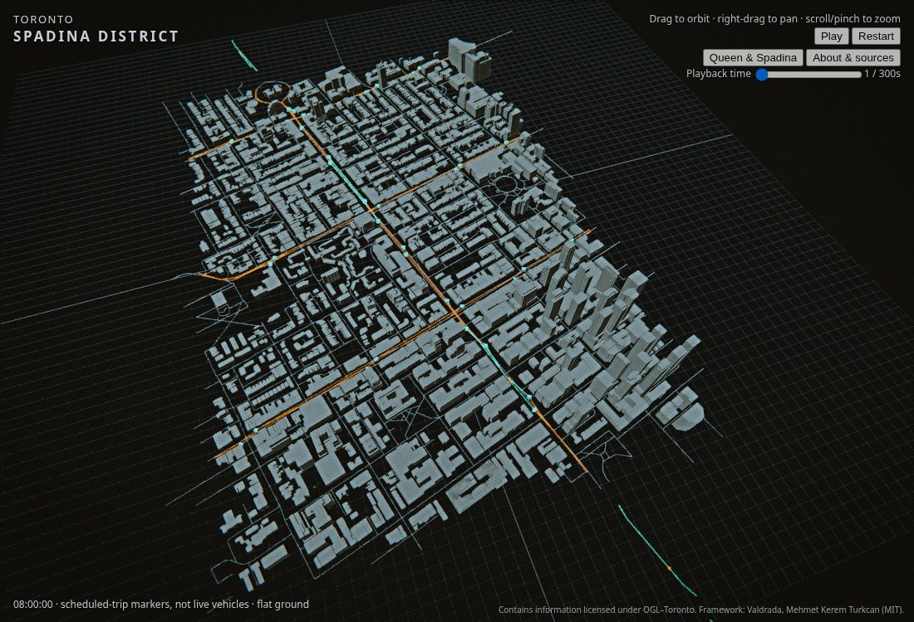

# Explore Toronto's Spadina district

Toronto's public records can form the starting point for a city simulation: buildings give it spatial context, streets describe connections, and transit schedules give movement a clock. This project brings those layers into the existing Valdrada framework, with the aim of testing urban mobility scenarios while keeping source observations separate from modeled behavior.



The browser uses the same tiled geometry, geographic frame and recorded actors as the headless world. It is a lightweight way to explore the model; it does not connect to a live transit feed or a hosted simulation server.

## A two-minute walkthrough

1. Open the main application using the instructions below. Choose **Queen & Spadina** to focus on the district. Drag to orbit, right-drag or use two fingers to pan, and scroll/pinch to zoom.
2. Watch the orange scheduled-trip symbols. Grey lines are City centrelines, ochre lines are GTFS service paths, blue points are stops, and teal links show occupied directed service links.
3. **Pause** and move the **Playback time** slider from 0 to 120 seconds. The slider pauses playback so that positions and occupancy can be inspected at a fixed time. Arrow keys move it by one second. **Restart** returns to the beginning.
4. Open **About & sources** for coverage, controls, source attribution and the distinction between measured records and modeled positions. Close it or press Escape to return to the city.

The recording runs from 08:00 to 08:05 on the pinned **2026-10-22 service day**, in **America/Toronto**. It stops after five minutes. The source timetable includes service times after 24:00, even though this short recording shows the morning.

## What the model contains

| Layer | Included | Boundary |
| --- | --- | --- |
| Buildings | 2,344 City massing records, 2,531 polygon parts, 19 streamed tiles | About 2.15 km² around Spadina; source heights on flat ground, not complete Toronto or detailed facades |
| Streets | 841 City centreline segments and intersection identifiers | Source context, not a lane or walkable-routing model |
| Transit context | Paths and 43 stops for 501, 505, 506 and 510 | GTFS geometry, not surveyed tracks |
| Moving transit | 378 route-510 trips across seven validated service patterns | Scheduled symbolic positions, not observed vehicles or interacting traffic |
| Experiment | One fixed +60-second stop dwell propagated downstream | An explicit what-if input, without recovery, passenger, signal or collision modeling |

The moving route continues beyond the building crop. The absence of a building or terrain tile beyond that crop is not evidence that a location is empty.

## Run the existing application

With Node 24, from the repository root:

```sh
npm ci --ignore-scripts
npm --prefix client ci --ignore-scripts
npm --prefix client run dev:city
```

Open the URL printed by Vite with `?city=toronto`. This regenerates the five-minute recording from the inherited world and opens its main renderer; no bulk data download, new credentials or backend is needed.

To inspect the extra-dwell experiment instead:

```sh
TORONTO_TRANSIT_SCENARIO=tools/toronto/scenarios/510-stop-dwell.json npm --prefix client run dev:city
```

The scenario adds 60 seconds at Spadina Avenue / Willcocks Street for one specified trip. It is labeled in the clock and source panel. Willcocks is just north of the building crop; transit coverage extends there. Other trips remain unchanged. See [the scenario contract](vision.md#fixed-extra-dwell-experiment) for exact inputs, timing and API access.

## A personal project page and a static Space

A useful presentation pairs this explanation and a Toronto screenshot with the interactive application. Link to the model and its sources rather than implying the whole upstream NYC feature set has been ported. The project follows [Valdrada's personal-site project page](https://mehmetkeremturkcan.com/valdrada/) and [static Space](https://huggingface.co/spaces/mehmetkeremturkcan/valdrada) as a presentation pattern; Toronto has different data and capability boundaries.

Build the precompiled static Space package:

```sh
npm --prefix client run build:space
python3 -m http.server 8000 --bind 127.0.0.1 --directory client/dist-space
```

Open `http://127.0.0.1:8000/`. The directory contains the same main application, relative asset URLs, a Space card (`sdk: static`, `app_file: index.html`), source provenance and licence notices. It needs WebGL2 on the visitor's device, not server compute or an external asset CDN. The existing GitHub Pages build remains separate and keeps its `/sixsim/` base path.

[Hugging Face's static SDK documentation](https://huggingface.co/docs/hub/spaces-sdks-static) describes free static serving without a compute instance. Preparing this directory does not create or publish a Space. Release requires an authorized Space owner/name, the owner's account access and approval to upload this package. No credentials are needed to build or inspect it locally. Host-specific behavior remains unverified until an authorized deployment is tested.

For a personal blog, use this page's explanation and screenshot, then link to the approved app URL. An optional iframe should use the actual URL supplied by the hosting platform, retain a descriptive title and a direct-link fallback, and be tested on mobile. See the [official embedding guide](https://huggingface.co/docs/hub/spaces-embed). No personal-site repository change is needed to prepare the app package.

## Sources and credit

The Toronto adaptation is maintained by Calen Irwin; **SixSim is a working name**. The simulation framework is [Valdrada](https://github.com/mkturkcan/valdrada), by Mehmet Kerem Turkcan, with its original copyright and licence preserved.

Contains information licensed under the Open Government Licence – Toronto. City building massing and centreline records and TTC GTFS retain source URLs, retrieval dates, checksums and transformation details in the [source register](data-sources.md). The register records the conflicting CKAN licence metadata alongside the official licence evidence; no City clarification or endorsement is implied. Code, documentation and source data have separate [licensing terms](../licensing.md).

Next development layers are explained in the [architecture and roadmap](vision.md): richer network topology, explicit behavioral assumptions and comparisons of reproducible scenarios. Photorealistic NYC footage, upstream sensors, traffic interaction and full-city coverage should not be presented as Toronto results.
